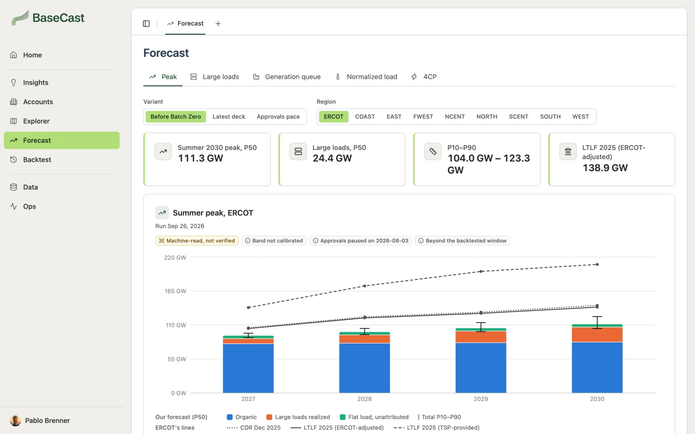
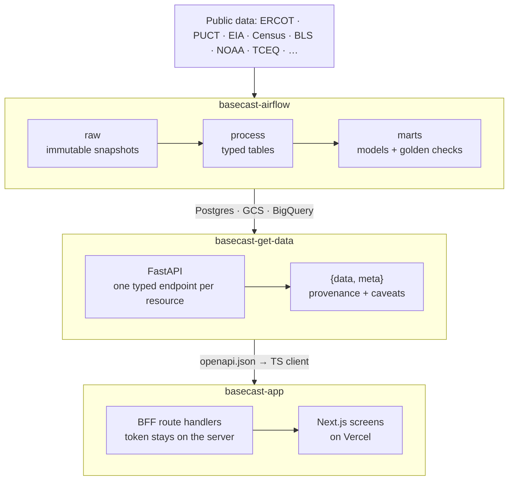

<picture>
  <source media="(prefers-color-scheme: dark)" srcset="basecast-app/docs/assets/logo-dark.svg">
  
</picture>

**How much of Texas' interconnection queue actually gets built: where, when, and which co-op to call about it.**

**Winner of the Open Grid Data track** at the
[Base Power × AITX Talent Hackathon](https://aitx-base-hackathon-showcase.vercel.app/projects/basecast)
(Austin, Sep 25–27, 2026), picked by Base Power's engineering team. A solo entry: the data pipelines, the API
and the app in this repo.

<picture>
  <source media="(prefers-color-scheme: dark)" srcset="basecast-app/docs/assets/forecast-dark.webp">
  
</picture>

Texas plans its grid around queues that are mostly paper: in January 2026 ERCOT tracked 232.5 GW of large
loads, 3.8% of them approved to energize. BaseCast forecasts how much of the queues gets built, turns that into
a **peak MW forecast by region and year (P10/P50/P90)**, and tells
[Base Power](https://www.basepowercompany.com)'s partnerships team **which co-ops and munis to approach, when,
and with what offer**.

## What's in here

| Folder | What it does | Stack |
|---|---|---|
| [`basecast-airflow/`](basecast-airflow/) | 35 public sources into an immutable lake, typed tables, and the models and marts behind every forecast | Python 3.12, Airflow, Polars, Postgres + PostGIS, BigQuery |
| [`basecast-get-data/`](basecast-get-data/) | The API: one typed endpoint per resource, every answer with its provenance; owns the data contract | FastAPI, Pydantic 2, Polars, OpenAPI 3.1 |
| [`basecast-app/`](basecast-app/) | The product: county map, peak forecast, backtest, and the ranked co-op accounts | Next.js 16, React 19, Tailwind 4, TanStack Query, MapLibre |

Each folder has its own README, toolchain and lockfile. They started as three repos and moved here on
2026-11-19 with their full history.

## How it fits

> [!NOTE]
> **The cloud side was shut down on 2026-09-29.** After the hackathon the GCP project (the Airflow VM, Cloud
> Run, Cloud SQL, the lake's bucket, BigQuery) was deleted to bring the bill to zero. The live demo serves a
> snapshot of the API's answers recorded that day (`basecast-app/snapshot/`). The pipelines and the API still
> run locally, against a lake rebuilt from the public sources.

## Author

Pablo Brenner · [LinkedIn](https://www.linkedin.com/in/brennerpablo/) · [pbrenner.com](https://www.pbrenner.com)
